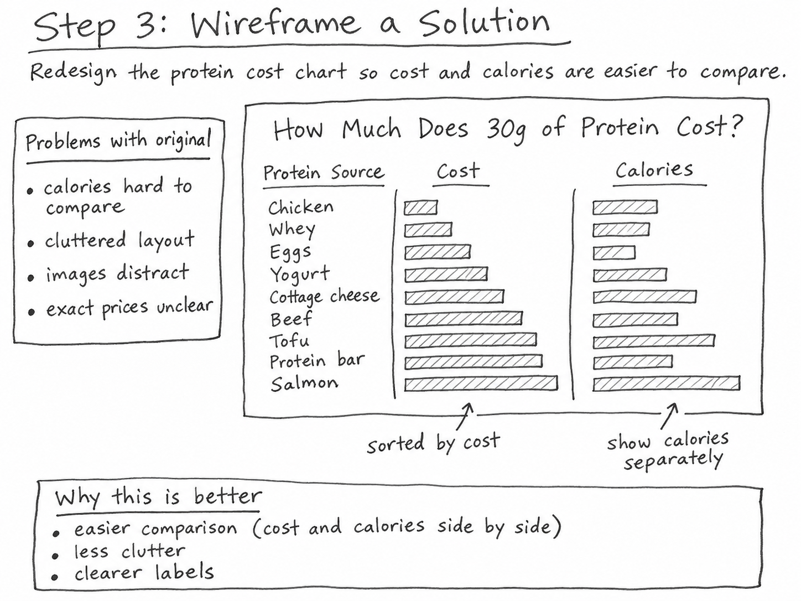
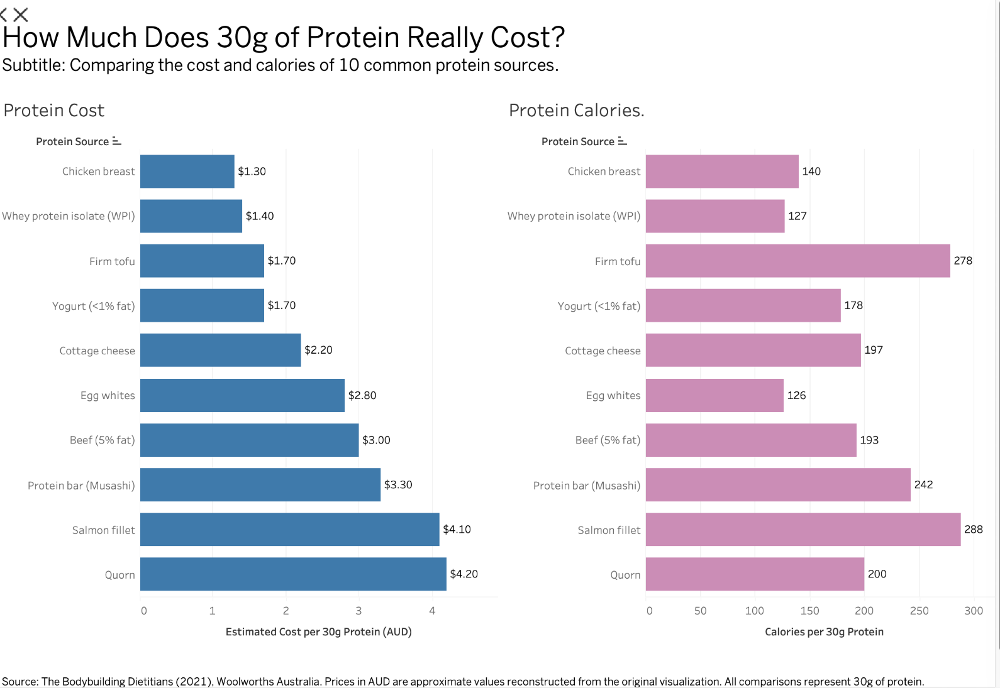

| [Home](./) | [Data viz examples](dataviz-examples) | [Critique 1](critique-by-design) | **[Protein cost redesign](protein-cost-redesign)** | [Final project I](final-project-part-one) | [Final project II](final-project-part-two) | [Final project III](final-project-part-three) |

# Critique by Design: How Much Does 30g of Protein Really Cost?

**MakeoverMonday redesign | Tableau Public | November 2026**

This project follows the same process I would use to improve a product experience: **identify a communication problem, sketch a solution, ask users to interpret it, then iterate**. I selected a professional infographic that compares the estimated price and calorie content of ten foods providing the same amount of protein. The goal was not to change the story or update food prices. It was to make the existing comparison easier to read.

**[Explore my redesigned dashboard in Tableau Public](https://public.tableau.com/app/profile/aditi.adgaonkar/viz/Book2_17943470761440/Dashboard1)** · [Jump to the final design](#step-5-my-tableau-redesign)

## Step 1: Select and understand the original visualization

The original infographic, **“How Much Does 30g of Protein Cost?”**, appeared in Jack Radford-Smith's November 26, 2021 article, *What Are The Cheapest High-Protein Foods?* for The Bodybuilding Dietitians. It was subsequently used as a source visualization for the MakeoverMonday 2023 Week 8 protein-cost challenge. I chose it because the question is immediately relatable: is a food that seems expensive by the package actually expensive when measured by the amount of protein it provides?

**[View the original article and infographic](https://www.thebodybuildingdietitians.com/blog/how-cost-effective-is-your-high-protein-diet)**

*Original: The Bodybuilding Dietitians (2021). Used here for critique and attributed to its creator. Price source listed as Woolworths Australia. The vertical bars encode cost for 30g of protein; the numbers written inside the bars indicate calories.*

The infographic compares Quorn, salmon fillets, a Musashi protein bar, lean beef, egg whites, cottage cheese, low-fat yogurt, firm tofu, whey protein isolate, and chicken breast. The price scale runs from zero to about five Australian dollars. Calories are shown for the food quantity needed to provide 30g of protein, not for a generic serving size. The original article also notes that price is not a complete measure of nutritional quality.

**Intended audience.** The likely readers are grocery shoppers interested in protein and affordability, especially students, athletes, and fitness-oriented consumers. Because the source is an Australian dietitian's website, the pricing context is local rather than a universal ranking of foods. In *Good Charts* terms, this is a **data-driven, declarative** graphic: it presents a defined comparison, rather than inviting open-ended exploration.

## Step 2: Critique with Stephen Few's Data Visualization Effectiveness Profile

I applied the seven criteria in Stephen Few's effectiveness profile, using a 1–10 scale to distinguish strengths from weaknesses. The scores reflect my evaluation, not a statistical measurement of quality.

| Criterion | Score | Why I gave this score |
|---|---:|---|
| **Usefulness** | **8/10** | Comparing the price of an equal amount of protein answers a useful shopping question. However, a 2021 snapshot from a single retailer does not directly describe other stores or present-day costs. |
| **Completeness** | **6/10** | Food names, a cost scale and calorie labels are present, but there are no exact dollar labels, product-level calculations, or individual price records. A reader cannot fully reproduce the numbers from the infographic alone. |
| **Perceptibility** | **6/10** | The vertical bars make the rough price ranking visible, but diagonal category labels slow scanning, and calories must be read one value at a time instead of compared by position or length. |
| **Truthfulness** | **7/10** | A common 30g-protein denominator is a fair basis for the intended cost comparison, and the retailer is identified. The limits are missing calculation details and the risk of interpreting a historic, approximate price ranking as current shopping advice. |
| **Intuitiveness** | **8/10** | A ranked bar chart is familiar and its question-based headline is easy to follow. The calorie labels inside price bars, however, can be mistaken for another part of the bar's cost encoding. |
| **Aesthetics** | **7/10** | Recognizable product images help make the comparison approachable, but their irregular size and placement compete with labels and bars. |
| **Engagement** | **7/10** | The topic invites a reader to check familiar foods, but the chart does little to support the natural follow-up: “Which food has both relatively low cost and relatively low calories?” |

### What was effective, and what needed to change?

The **strongest choice is the 30g-protein denominator**. Comparing packages at the register would mix different package sizes and protein densities, while comparing the same protein quantity lets a reader assess affordability more consistently. The simple price ranking is also appropriate; I did not want to replace it with an unfamiliar graphic for the sake of novelty.

The **central weakness is an imbalance between the two measures**. Price is encoded visually, but calories are relegated to numbers printed inside price bars. This requires the reader to scan back and forth, memorize calorie figures, and mentally compare them. The slanted labels and product photos add more effort without helping the calorie comparison. Exact costs are not stated, even though price is the headline variable.

There is an important *interpretation* issue too. Low cost does not establish that a food is healthier, more convenient, or appropriate for everyone. The source article itself encourages a varied diet. In the redesign I wanted to preserve that distinction rather than imply a nutritional recommendation.

### How useful is Few's approach compared with *Good Charts*?

Few's rubric helped turn a general reaction (“this looks busy”) into **specific issues that could guide a redesign**: data completeness, mark encoding, label legibility, and audience usefulness. It also forced me to record what was working instead of treating the original as simply bad.

Chapter 3 of Scott Berinato's *Good Charts* begins one step earlier, by asking whether the visualization is conceptual or data-driven and whether its purpose is declarative or exploratory. That framing mattered here because shoppers need a clear comparison, not a complex analytic tool. **Good Charts clarified the communication goal; Few identified how well the design accomplished it.**

I also saw limitations in Few's numerical ratings. Perceptibility and intuitiveness overlap, and the difference between a 6 and a 7 can become subjective. Neither a checklist nor a score proves that an audience understands the message. Observing real readers is a necessary complement to expert critique, which motivated my next steps.

## Step 3: Sketch a solution before opening Tableau

I prepared a deliberately simple **hand-drawn-style concept** rather than polishing an illustration first. The central proposal was to keep the same foods in the same rows, show a **horizontal cost bar chart on the left**, and add a **separate horizontal calorie bar chart on the right**. The price ranking would stay visible, while calories would become a genuine visual comparison.

*Hand-drawn-style concept wireframe used for discussion. Its bar lengths are schematic and not intended as actual measured values. The creation method is documented separately.*

| Observation from critique | Proposed design response |
|---|---|
| Hard to compare calories | Add a second set of bars on a separate calorie axis. |
| Angled labels require effort | Use horizontal food names, aligned with the same rows in both views. |
| Exact costs not shown | Label the reconstructed estimates explicitly as approximations. |
| Both measures feel mixed together | Use distinct colors and clear headers for AUD and kcal. |
| Pricing context is easy to miss | Put the source, 2021 time context, and reconstruction limitations near the chart. |

A second idea was to use a scatterplot of cost versus calories. I rejected it for the main design because a ranked bar chart better serves the original practical question (“What is cheapest?”), while two aligned charts preserve price order and still expose calorie differences. The sketch was therefore a design hypothesis, not a claim that the problem had already been solved.

## Step 4: Test the wireframe with two readers

I showed the wireframe to two people and gathered their reactions to its readability and clarity. The questions focused on what the graphic showed, what was easy or confusing, whether a reader could compare cost and calories, and what they would change. The notes below are **paraphrases of feedback that the participants agreed with**, not quotations or verbatim transcripts; I have not attributed names or identifiable details.

| Feedback topic | Participant 1 | Participant 2 |
|---|---|---|
| **Initial interpretation** | Understood that foods were being compared on price and calories. | Understood the two-variable comparison and the aligned food rows. |
| **What worked** | Found the side-by-side layout easier to follow than reading calories inside price bars. | Found the simpler layout readable and the horizontal categories straightforward. |
| **What needed clarification** | Wanted actual cost figures and a clear currency, rather than only schematic bar lengths. | Wanted explicit units and a statement that both measures apply to the amount of food providing 30g of protein. |
| **Suggested improvement** | Add numeric value labels and identify AUD. | Label both axes clearly and explain the common denominator. |

### What I learned, and what changed

The participants agreed on the broad direction, but their suggestions emphasized different risks: **Participant 1 focused on actionable numbers**, while **Participant 2 focused on avoiding a misleading interpretation of the units**. The first response influenced the use of value labels; the second led me to make “per 30g of protein” explicit in the axis titles and source note.

After this test I kept the aligned layout and introduced blue cost bars, purple calorie bars, clear numerical labels, and a note that the prices are approximations derived from the original visualization. The important lesson was that removing clutter is only successful if the remaining chart provides enough context to stand on its own.

*Limit of this test:* These were two qualitative reactions, not a representative usability study. I did not measure reading time or error rates, and therefore cannot claim the redesign is quantitatively faster or more accurate.

## Step 5: My Tableau redesign

I created the final visualization in Tableau Public using two aligned horizontal bar charts. The blue chart ranks food sources by **estimated AUD cost per 30g protein**; the purple chart shows **calories for the same 30g protein**. Both preserve the same row order, so a reader can look straight across to compare the measures. Exact calorie labels and clearly marked approximate cost labels reduce the need to interpret bar lengths alone.

**[Open the interactive Tableau dashboard](https://public.tableau.com/app/profile/aditi.adgaonkar/viz/Book2_17943470761440/Dashboard1)**

*Screenshot of my Tableau Public dashboard. The interactive version is linked above. Values reflect the original 2021 comparison; cost estimates are not a current grocery survey.*

<iframe src="https://public.tableau.com/views/Book2_17943470761440/Dashboard1?:showVizHome=no&amp;:embed=true" width="100%" height="650" title="Interactive Tableau dashboard comparing protein costs and calories" loading="lazy" style="border:0;"></iframe>

### What the redesign makes easier to see

The cost ranking is more legible because the foods are listed horizontally and the estimated dollar amounts are explicit. Looking across the rows also reveals why a low price is not necessarily the same as a low calorie amount: **firm tofu and low-fat yogurt have similar estimated costs for 30g of protein, but the source chart reports 278 kcal for tofu and 178 kcal for yogurt**. Likewise, egg whites are about 126 kcal compared with 197 kcal for cottage cheese, while the reconstructed costs put egg whites higher in price. These comparisons were possible in the original, but took more manual reading.

The redesign intentionally uses **two different scales** because dollars and kilocalories have different units. The lengths of bars across the two charts should not be directly compared to each other; the appropriate comparisons are *within* each measure and *across food rows*.

### Reconstructing the source data transparently

The original infographic supplies **ten exact displayed calorie labels** and approximate price positions on an AUD dollar axis, but it does not publish a table of individual price records or the underlying product calculations. I transcribed the calories and estimated costs from the chart's y-axis, rounded to the nearest A$0.10. The price figures below are **reconstructions from a published graphic, not verified retailer receipts or current price data**. To avoid false precision, the `~` symbol is intentional.

[Download the Tableau input CSV, with the provenance field for every row](protein-cost-data.csv)

| Food | Reconstructed cost per 30g protein | Calories per 30g protein | Evidence and limitation |
|---|---:|---:|---|
| Quorn | ~A$4.20 | 200 kcal | Cost read approximately from the original y-axis; calorie label transcribed |
| Salmon fillet | ~A$4.10 | 288 kcal | Cost read approximately from the original y-axis; calorie label transcribed |
| Protein bar (Musashi) | ~A$3.30 | 242 kcal | Cost read approximately from the original y-axis; calorie label transcribed |
| Beef (5% fat) | ~A$3.00 | 193 kcal | Cost read approximately from the original y-axis; calorie label transcribed |
| Egg whites | ~A$2.80 | 126 kcal | Cost read approximately from the original y-axis; calorie label transcribed |
| Cottage cheese | ~A$2.20 | 197 kcal | Cost read approximately from the original y-axis; calorie label transcribed |
| Yogurt (<1% fat) | ~A$1.70 | 178 kcal | Cost read approximately from the original y-axis; calorie label transcribed |
| Firm tofu | ~A$1.70 | 278 kcal | Cost read approximately from the original y-axis; calorie label transcribed |
| Whey protein isolate (WPI) | ~A$1.40 | 127 kcal | Cost read approximately from the original y-axis; calorie label transcribed |
| Chicken breast | ~A$1.30 | 140 kcal | Cost read approximately from the original y-axis; calorie label transcribed |

**Reproduction method:** (1) use the original author graphic from the linked 2021 article; (2) identify each food and transcribe its printed calorie value; (3) estimate bar heights using the original dollar-axis grid lines, with 0 at the chart baseline; (4) round estimated prices to A$0.10; (5) preserve the full set of ten foods and 30g basis in the Tableau input file. Costs shown as ties after rounding (such as yogurt and tofu) should not be interpreted as exact equal prices.

### Independent visual cross-check of reconstructed prices

To test the price reconstruction rather than merely assert that it looked close, I performed a **second check against the visible bar endpoints in the original 2021 infographic**. On the displayed 1,000 × 1,000-pixel source image, the chart’s AUD $0 baseline is approximately at vertical pixel **779**, and its AUD $5 gridline is approximately at **226**. Reading each bar top on that same image gives an independent approximate estimate by linear interpolation:

`AUD estimate = 5 × (779 − bar-top y) / (779 − 226)`

| Protein source | Approx. bar-top y (px) | Image-interpolated AUD | Used in Tableau (AUD) | Absolute difference |
|---|---:|---:|---:|---:|
| Quorn | ~316 | ~$4.19 | ~$4.20 | $0.01 |
| Salmon fillet | ~332 | ~$4.04 | ~$4.10 | $0.06 |
| Protein bar (Musashi) | ~411 | ~$3.33 | ~$3.30 | $0.03 |
| Beef (5% fat) | ~453 | ~$2.95 | ~$3.00 | $0.05 |
| Egg whites | ~466 | ~$2.83 | ~$2.80 | $0.03 |
| Cottage cheese | ~535 | ~$2.21 | ~$2.20 | $0.01 |
| Yogurt (<1% fat) | ~594 | ~$1.67 | ~$1.70 | $0.03 |
| Firm tofu | ~596 | ~$1.65 | ~$1.70 | $0.05 |
| Whey protein isolate (WPI) | ~629 | ~$1.36 | ~$1.40 | $0.04 |
| Chicken breast | ~638 | ~$1.27 | ~$1.30 | $0.03 |

The differences are **all below A$0.06** between this independently read graphical estimate and the already-published reconstructed cost values. This supports the accuracy of the recreation **at the scale visible in the original chart**; it does **not** establish exact Woolworths prices, which the author did not publish as numerical records. Both the bar-top locations and the reference gridline positions are approximate readings of the rendered graphic, so very small differences should not be interpreted as meaningful precision. The original category order and all ten calorie annotations have also been preserved.

[Download the row-by-row visual validation audit](protein-cost-visual-validation.csv) · [View the original image used for the check](https://images.squarespace-cdn.com/content/v1/5d59f351fddabe00013cf3e6/f9b4b336-fe23-4260-aae3-19f6f8f72b8b/PROTEIN%2BCOST.png)

**Important:** The associated 2023 MakeoverMonday challenge was also described in some published redesigns using a different, 20g-protein dataset. This project instead recreates the **original 2021 infographic's 30g-protein comparison throughout**. I have not mixed 20g and 30g values or presented them as interchangeable.

## Step 6: Reflection and limitations

This exercise changed how I think about redesigns. The biggest improvement did not require adding complexity. The original chart already had an engaging question and a defensible comparison basis. The problem was that cost and calories were both important, but only cost had a visual encoding. Keeping the ranked price comparison while introducing an aligned calorie chart made my design choices directly traceable to the critique.

The wireframe helped me test the information hierarchy before spending time on Tableau formatting. The two readers’ feedback was useful because it questioned what I had left implicit: numerical labels, units, and the 30g standard. In Tableau, I learned that consistent sorting and row alignment matter as much as the chart type. I also learned that data provenance is part of a visualization's integrity. Reconstructing values from an old chart is acceptable only if I clearly communicate the uncertainty rather than present approximations as precise historical facts.

**What I would do next:** If original retailer price records were available, I would rebuild the chart with those exact inputs and document the calculation of cost per 30g of protein. I would also test the finished dashboard on mobile and ask readers to answer specific comparison questions without guidance. I did not collect evidence for those additional tests here.

## Sources and references

- Jack Radford-Smith (November 26, 2021). [*What Are The Cheapest High-Protein Foods?*](https://www.thebodybuildingdietitians.com/blog/how-cost-effective-is-your-high-protein-diet). The Bodybuilding Dietitians. Original infographic and calorie labels; the article identifies Woolworths Australia as its source of cost values.
- MakeoverMonday (2023, Week 8). [MakeoverMonday data challenges](https://www.makeovermonday.co.uk/data/).
- Stephen Few. [*Data Visualization Effectiveness Profile*](https://www.perceptualedge.com/articles/visual_business_intelligence/data_visualization_effectiveness_profile.pdf).
- Scott Berinato (2016). *Good Charts: The HBR Guide to Making Smarter, More Persuasive Data Visualizations*, chapters 3–4. Harvard Business Review Press.
- [My published Tableau dashboard](https://public.tableau.com/app/profile/aditi.adgaonkar/viz/Book2_17943470761440/Dashboard1).

**[Tool and AI-use disclosure](protein-cost-ai-acknowledgment)**

[← Back to portfolio homepage](./)
